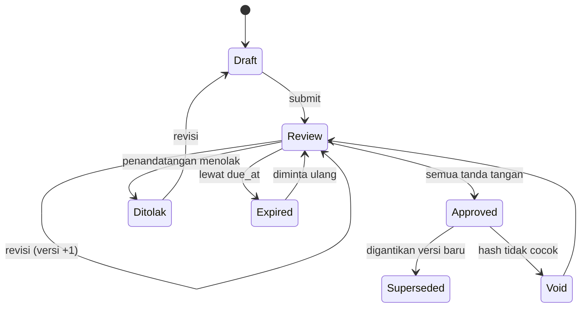
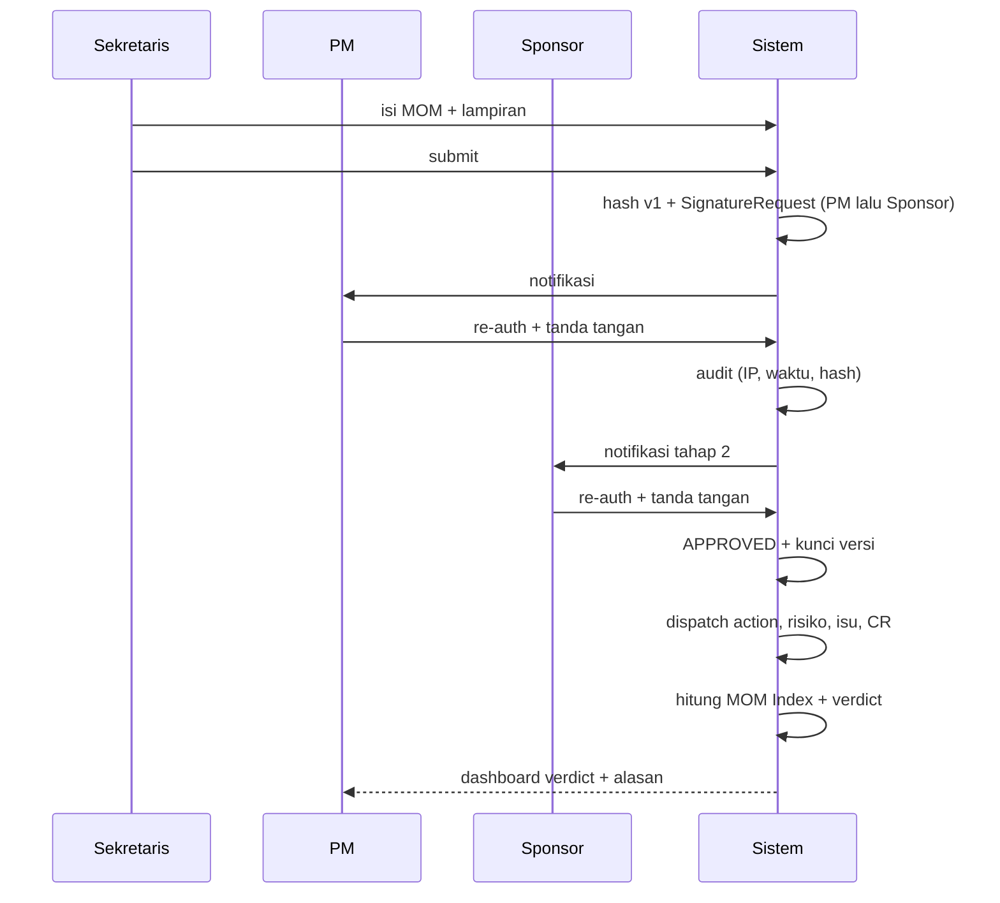

# Alur MOM & Tanda Tangan Elektronik

## A. Peta besar

```text
Sponsor/PM  ──▶ rapat terjadwal
Sekretaris  ──▶ MOM Draft (agenda · keputusan · action · risiko · isu · lampiran)
                     │
                     ▼
              submit → MOM v1 + content_hash (SHA-256)
                     │
                     ▼
        Signature Request sesuai matriks tipe rapat
             ┌───────┴────────┐
        ditolak/revisi   semua tanda tangan
             │                │
             ▼                ▼
      DRAFT (tanpa dampak)  APPROVED (versi terkunci)
                              │
                              ▼
                    dispatch dampak:
                    action → My Tasks, risiko → register,
                    isu → issue log, keputusan mayor → CR,
                    snapshot EVM tersimpan
                              │
                              ▼
                    MOM Health Index + verdict proyek
```

## B. State machine



## C. Sequence penandatanganan



## D. Gating dampak

| Status MOM | Action item | Risiko/isu | Keputusan → CR | Hitung MOM Index | Dashboard |
| --- | --- | --- | --- | --- | --- |
| Draft/Review | usulan | ✗ | ✗ | ✗ | badge "menunggu tanda tangan" |
| Approved | ditugaskan | ✓ | ✓ | ✓ | memengaruhi verdict |
| Ditolak | batal | ✗ | ✗ | ✗ | badge "perlu revisi" |
| Expired | batal | ✗ | ✗ | ✗ | sinyal governance |
| Superseded | wajib review | riwayat tetap | riwayat tetap | versi terakhir | badge "digantikan" |

## E. Komponen MOM Health Index

| Komponen | Bobot | Sumber |
| --- | --- | --- |
| Disiplin action item | 30% | tepat waktu vs terlambat |
| Tindak lanjut keputusan | 20% | FOLLOWED_UP vs keputusan mayor tanpa CR |
| Tren risiko & isu | 20% | risiko tinggi baru, risiko ditutup, isu kronis |
| Keterlibatan | 15% | quorum, kehadiran sponsor, acknowledge |
| Nada notulen | 15% | proporsi kalimat bermasalah |

Sinyal keras: ≥3 action terlambat > 14 hari · keputusan mayor tanpa CR > 7 hari ·
isu berulang ≥ 3 rapat · MOM > 3 hari belum ditandatangani · sponsor absen mayoritas · on-time < 50%.

## F. Tingkat e-sign

| Tier | Isi | Kapan |
| --- | --- | --- |
| 1 | klik + re-auth password + hash + audit log | dipakai sekarang |
| 2 | TTE tersertifikasi PSrE (mis. BSrE/Privy/VIDA) | integrasi lanjutan |
| 3 | e-Meterai | tidak dipakai untuk MOM internal |

## G. Matriks penandatangan

| Tipe rapat | Penandatangan | Pola |
| --- | --- | --- |
| Kickoff | PM → Sponsor | berurutan |
| Weekly status | PM | tunggal |
| Gate review | PM → Sponsor | berurutan |
| CCB | Ketua CCB → PM | berurutan |
| Steering | Sponsor | tunggal |
| Closure | PM → Sponsor | berurutan |

## H. Jalur pengecualian

| Kejadian | Perilaku |
| --- | --- |
| Penandatangan menolak | kembali Draft, alasan tercatat, tanpa dampak |
| Lewat batas waktu | status Expired, dampak tetap tertahan |
| Isi diubah setelah tanda tangan | hash mismatch → Void → wajib versi baru |
| Penandatangan berhalangan | delegasi resmi (`delegated_from`), tetap satu tanda tangan |
| MOM digantikan | versi lama Superseded, objek turunan masuk daftar review |
| Rapat batal | status Cancelled, tidak dihitung sebagai kegagalan kepatuhan |
| Bukan penandatangan mencoba tanda tangan | ditolak (identitas = akun login + re-auth) |
